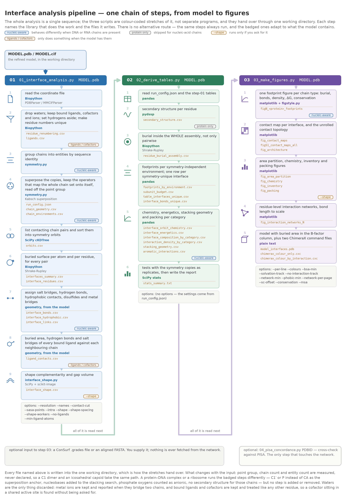

# interface-analysis

**What holds a protein assembly together — measured, not eyeballed.**

A small, dependency-light pipeline that takes one refined coordinate file (`.pdb` or
`.cif`) and returns a complete, publication-ready description of every interface in it:
which residues are buried, by how much, against whom, through which chemistry, and how
well the two surfaces actually fit.

It was built for a cryo-EM bacteriophage tail with exact C3 symmetry, but nothing in it
is specific to that structure. The point group, the number of chains and the number of
distinct proteins are **measured from the model**, never declared, so a C1 heterodimer,
a D18 ring, an icosahedral capsid, a protein–DNA complex and a ribosome all take the
same path through the same three scripts.

[](https://colab.research.google.com/github/davismerighi-max/interface-analysis/blob/main/notebooks/interface_analysis_colab.ipynb)

*No installation, no programming: click the badge, upload your model, run the cells,
download a zip of every table and figure.*

<p align="center"></p>

---

## What you get

| | |
|---|---|
| **Symmetry** | point group, symmetry operators, which chains are copies of which, and the symmetry-independent **environments** a subunit can sit in |
| **Interfaces** | every contacting chain pair, grouped into exact symmetry orbits, with buried surface area per interface, per residue and per atom |
| **Chemistry** | salt bridges, hydrogen bonds, hydrophobic contacts, disulfides, metal bridges, cation–π, aromatic stacking and base stacking — each one listed with its distance and geometry |
| **Energetics** | Eisenberg–McLachlan atomic solvation ΔG per interface, split into what the burial pays for and what it costs |
| **Packing** | shape complementarity *S*<sub>c</sub> and gap index per interface (Lawrence & Colman), on a solvent-excluded surface |
| **Ligands** | buried area, hydrogen bonds and salt bridges for every bound cofactor against each neighbouring chain — a ligand in a shared active site is found without being asked for |
| **Statistics** | the symmetry copies are used as genuine replicates; category comparisons come with non-parametric tests and effect sizes |
| **Figures** | per-protein interface footprints, contact maps, interaction networks with bond lengths to scale, architecture, area partition, chemistry and packing panels |
| **ChimeraX** | the model with buried area in the B-factor column, plus two ready-to-run `.cxc` command files |

<p align="center">


</p>

---

## Quick start

```bash
git clone https://github.com/davismerighi-max/interface-analysis.git
cd interface-analysis
pip install -r requirements.txt

# everything runs in one working directory, in this order
python 01_interface_analysis.py  MODEL.pdb  --resolution 2.6  --shape
python 02_derive_tables.py       MODEL.pdb
python 03_make_figures.py        MODEL.pdb
```

That is the whole pipeline. Step 01 writes the measurements, step 02 derives the tables
and the statistics report, step 03 draws the figures. Each step reads what the previous
one left in the directory, so you can re-run step 03 with different figure options
without repeating the expensive work.

**Nothing in steps 01–03 touches the network.** They run unchanged on an air-gapped
cluster node. The only script that makes a request is the optional
`04_pisa_concordance.py`, and even that accepts a pre-downloaded JSON instead.

### Naming your chains

```bash
python 01_interface_analysis.py MODEL.pdb --names "D,E,F,G,H,I,J,K,L=tube; A,B,C=belt"
python 03_make_figures.py       MODEL.pdb --colours "tube=#7FA8D4; belt=#E8884A"
```

Without `--names` the entities are called `protein_1`, `protein_2`, … in order of size.

---

## Options

**`01_interface_analysis.py`** — `--resolution` (quotes the map/data resolution in every
report and sets the distance tolerances) · `--names` · `--contact-cut` (5.0 Å) ·
`--sasa-points` (100) · `--intra` (also analyse contacts within a chain) · `--shape`
(shape complementarity and gap index; the slow part) · `--shape-spacing` (0.5 Å) ·
`--shape-workers` · `--no-ligands` · `--min-ligand-atoms` (5)

**`02_derive_tables.py`** — no options; it reads the settings back from `run_config.json`.

**`03_make_figures.py`** — `--per-line` (350 residues) · `--colours` · `--bsa-min` ·
`--solvation-track` · `--no-interaction-track` · `--network-min` · `--phobic-min` ·
`--network-per-page` · `--sc-offset` · `--conservation` (a ConSurf `.grades` file) ·
`--msa` (an aligned FASTA)

**`04_pisa_concordance.py PDBID`** — optional cross-check of the buried areas against
PISA at the PDBe. `--pisa-json FILE` uses a file you downloaded yourself.

---

## Reading the numbers honestly

Three things are easy to misquote, so they are stated here and repeated in every report
the pipeline writes.

1. **Buried area** is computed pairwise in isolation — chain A alone, chain B alone, the
   AB pair — which is the PISA convention, and reported **halved** (the interface area,
   not the sum of the two footprints). It is therefore directly comparable to PISA, and
   *not* comparable to a number obtained by subtracting from the whole assembly. Step 02
   additionally reports burial inside the complete assembly, which is the right quantity
   for asking how exposed a residue really is.
2. **Shape complementarity** is computed here on a grid-based solvent-excluded surface.
   This implementation reads about **0.10 below** the original `sc` program's scale:
   trypsin–BPTI (2PTC) gives 0.647 and the obligate histone-fold heterodimers of the
   nucleosome (1KX5) give 0.598–0.620, against ~0.70 published. The class names in the
   figure are Lawrence & Colman's, drawn on the *original* scale, so they read
   pessimistically. Use *S*<sub>c</sub> to rank interfaces **within one run at one grid
   spacing**; do not quote the class name without this caveat. `--sc-offset` shifts the
   band edges onto the measured scale if you prefer.
3. **ΔG** uses the Eisenberg & McLachlan atomic solvation parameters, which were fitted
   for the twenty amino acids only. Nucleic acid and ligand atoms contribute buried area
   but σ = 0, so a ΔG for an interface involving them is a protein-side figure. It is an
   empirical solvation term, not a binding free energy — no entropy, no electrostatics.

Two conventions that matter for symmetric assemblies:

- Interfaces are grouped into **exact point-group orbits**, never into tolerance-based
  clusters. Two interfaces are the same interface only if a symmetry operator of the
  assembly maps one onto the other.
- Footprints are reported **per symmetry-independent environment**, never averaged across
  them. In the tail this matters: the same protein in two different environments
  correlates at r = 0.55–0.82, which is not the same footprint.

---

## Validated on

| structure | why |
|---|---|
| **2PTC** trypsin–BPTI, 1.9 Å | *S*<sub>c</sub> calibration against the published value |
| **1KX5** nucleosome, 1.9 Å | nucleic acids: base stacking, cation–π, DNA footprints; obligate heterodimers as the *S*<sub>c</sub> control |
| **9O7M** YfdQ, cryo-EM 3.9 Å, D18 | a large high-symmetry assembly; concordance with PISA |
| **4HHB** haemoglobin | cofactors that are *not* at an interface (one haem grazes a partner at 1.2 Ų) |
| **2TSC** thymidylate synthase | a cofactor that *is*: dUMP buries 34.3 Ų against the partner subunit with 4 H-bonds |
| **3GRS** glutathione reductase | a single chain in the file — no interface, and it says so instead of failing |

---

## Running it with an AI assistant

The repository is written to be handed straight to a coding assistant (Claude Code,
Claude Science, or any agent with a shell). Clone it, point the assistant at this README,
and ask it to run the three steps on your model — every script prints its own `--help`,
every output is a plain CSV with a header row, and the whole analysis is reproducible
from `run_config.json`. Because nothing is fetched from the network, an assistant running
inside a sandbox gets exactly the same numbers as a workstation.

---

## Requirements

Python ≥ 3.9 with Biopython, NumPy, pandas, SciPy, matplotlib, pydssp and scikit-image
(`pip install -r requirements.txt`). No compiled extensions, no external programs. A
30-chain, 4,600-residue model takes a few minutes; `--shape` is the expensive option and
is threaded.

## Licence

MIT — see [LICENSE](LICENSE). If it helps your work, a citation is appreciated.
