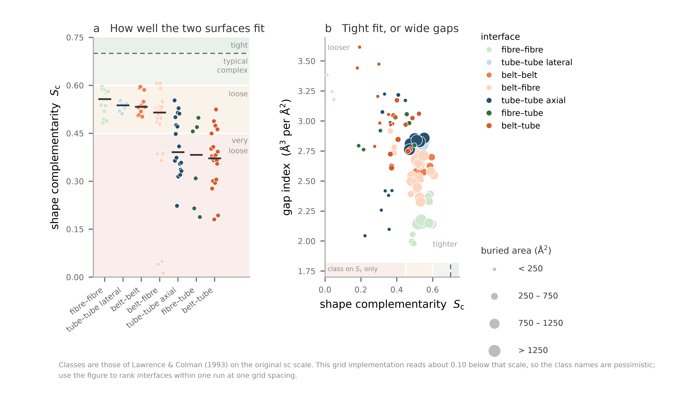

# interface-analysis

**What holds a protein assembly together — measured, not eyeballed.**

A small, dependency-light pipeline that takes one refined coordinate file (`.pdb` or
`.cif`) and returns a complete, publication-ready description of every interface in it:
which residues are buried, by how much, against whom, through which chemistry, and how
well the two surfaces actually fit.

It was built for a cryo-EM bacteriophage tail with exact C3 symmetry, but nothing in it
is specific to that structure. The point group, the number of chains and the number of
distinct proteins are **measured from the model**, never declared, so a C1 heterodimer,
a D18 ring, an icosahedral capsid, a protein–DNA complex and a ribosome all take the
same path through the same three scripts.

[](https://colab.research.google.com/github/davismerighi-max/interface-analysis/blob/main/notebooks/interface_analysis_colab.ipynb)

*No installation, no programming: click the badge, upload your model, run the cells,
download a zip of every table and figure.*

<p align="center"></p>

---

## What you get

| | |
|---|---|
| **Symmetry** | point group, symmetry operators, which chains are copies of which, and the symmetry-independent **environments** a subunit can sit in |
| **Interfaces** | every contacting chain pair, grouped into exact symmetry orbits, with buried surface area per interface, per residue and per atom |
| **Chemistry** | salt bridges, hydrogen bonds, hydrophobic contacts, disulfides, metal bridges, cation–π, aromatic stacking and base stacking — each one listed with its distance and geometry |
| **Energetics** | Eisenberg–McLachlan atomic solvation ΔG per interface, split into what the burial pays for and what it costs |
| **Packing** | shape complementarity *S*<sub>c</sub> and gap index per interface (Lawrence & Colman), on a solvent-excluded surface |
| **Ligands** | buried area, hydrogen bonds and salt bridges for every bound cofactor against each neighbouring chain — a ligand in a shared active site is found without being asked for |
| **Assemblies** | which parts of the model could exist on their own: the model is taken apart weakest interface first, every piece is classified with a written reason, disulfides are tracked separately, and each candidate is saved as its own PDB |
| **Run report** | `run_report.txt`: every part of every step marked ok / DEFAULT / WARNING / SKIPPED / FAILED with the reason, so a problem is found in seconds and one failed figure never stops the rest |
| **Statistics** | the symmetry copies are used as genuine replicates; category comparisons come with non-parametric tests and effect sizes |
| **Figures** | per-protein interface footprints, contact maps, interaction networks with bond lengths to scale, architecture, area partition, chemistry and packing panels |
| **ChimeraX** | the model with buried area in the B-factor column, plus two ready-to-run `.cxc` command files |

<p align="center">


</p>

---

## Quick start

```bash
git clone https://github.com/davismerighi-max/interface-analysis.git
cd interface-analysis
pip install -r requirements.txt

# one working folder per model; the code can stay where you cloned it
mkdir -p runs/MODEL && cp MODEL.pdb runs/MODEL/ && cd runs/MODEL
CODE=../..        # the cloned repository
python $CODE/01_interface_analysis.py  MODEL.pdb  --resolution 2.6
python $CODE/02_derive_tables.py       MODEL.pdb
python $CODE/03_make_figures.py        MODEL.pdb
python $CODE/05_assemblies.py          MODEL.pdb  --render
python $CODE/06_organise_results.py    MODEL.pdb   # -> MODEL_results/, one folder per figure
```

That is the whole pipeline. Step 01 writes the measurements, step 02 derives the tables
and the statistics report, step 03 draws the figures, step 05 proposes candidate
assemblies, step 06 copies the results into `MODEL_results/`: one folder per figure with
its PNG, PDF and the tables it was drawn from, plus `00_report/`, `inputs/`, `code/` and
`logs/`, indexed in `README.txt`. After any step, open `run_report.txt` to see what worked,
what ran with defaults and what failed.

Use **one working folder per model**. A file name like `fig1_<protein>_footprints` depends
on the protein name, so a second model (or a second name) in the same folder adds new files
next to the old ones rather than replacing them; step 06 only collects the files of the
current run (each step records what it wrote in `run_manifest.json`), and step 01 empties
the tables an earlier model left that this one does not produce (ligands, cross-links). Each step reads what the previous
one left in the directory, so you can re-run step 03 with different figure options
without repeating the expensive work.

**Nothing in steps 01–03 touches the network.** They run unchanged on an air-gapped
cluster node. The only script that makes a request is the optional
`04_pisa_concordance.py`, and even that accepts a pre-downloaded JSON instead.

### Naming and colouring your proteins

The simplest way is a FASTA file whose headers carry the name and, optionally, a colour:

```
>tube_#7FA8D4
MSKLTRVENAL...
>belt_#E8884A
MAQ...
```

```bash
python 01_interface_analysis.py MODEL.pdb --proteins proteins.fasta
```

Records are matched to the model **by sequence** (≥ 90 % of the modelled residues), so
the order does not matter, the full-length sequence is fine even if loops are missing,
and extra records are ignored. Anything that does not match runs with the defaults and
is listed in `run_report.txt`. The colours carry through every later step.

Alternatively, `--names tube,belt,fibre` names the proteins in order of first appearance
in the file, and `03_make_figures.py --colours "tube=#7FA8D4,belt=#E8884A"` pins colours.
Without either, proteins are called `entity_1`, `entity_2`, … Keep names short: they
label every axis.

---

## Options

**`01_interface_analysis.py`** — `--resolution` (quotes the map/data resolution in every
report and sets the distance tolerances) · `--proteins FASTA` · `--names` · `--contact-cut` (5.0 Å) ·
`--sasa-points` (100) · `--intra` (also analyse contacts within a chain) · `--no-shape`
(skip shape complementarity and gap index, on by default; the slow part) · `--shape-spacing` (0.5 Å) ·
`--shape-workers` · `--no-ligands` · `--min-ligand-atoms` (5)

**`02_derive_tables.py`** — no options; it reads the settings back from `run_config.json`.

**`03_make_figures.py`** — `--per-line` (350 residues) · `--colours` · `--bsa-min` ·
`--solvation-track` · `--no-interaction-track` · `--network-min` · `--phobic-min` ·
`--network-per-page` · `--sc-offset` · `--conservation` (a ConSurf `.grades` file) ·
`--msa` (an alignment — aligned FASTA, A3M from ColabFold/HHblits, Clustal or Stockholm;
`--msa tube=tube.a3m,belt=belt.fasta` for several proteins. The first sequence is the
reference; it is aligned to the modelled sequence, so a full-length reference is fine.
Grades are entropy-based, not ConSurf. Without an alignment the footprints simply have no
conservation track)

**`04_pisa_concordance.py PDBID`** — optional cross-check of the buried areas against
PISA at the PDBe. `--pisa-json FILE` uses a file you downloaded yourself.

Step 03 also draws two licorice renders of the whole model — `fig_render_budget`
(each residue in the colour of the protein that buries it) and `fig_render_interactions`
(the most specific interaction it makes) — for a quick 3D picture without ChimeraX.
`--render-view 0,0` gives a side view; `--no-render` skips them.

**`05_assemblies.py`** — `--render` (licorice figure of the main candidates) ·
`--min-kept` (0.50) · `--strong-kept` (0.67) · `--min-area` · `--colours` · `--no-pdb`

---

## Candidate assemblies

`05_assemblies.py` takes the model apart weakest interface first — always a whole
symmetry orbit at a time — and classifies every piece that appears
(`assembly_candidates.csv`, with a `reason` column written in words):

| kept | class | meaning |
|---|---|---|
| ≥ 67 % | strong candidate | breaks less than half of what it keeps |
| ≥ 50 % | candidate | keeps more than it breaks |
| < 50 % | not supported by contacts alone | |
| any | covalent unit | every chain joined by disulfides: survives non-reducing conditions |

*kept* is the share of a piece's buried area that stays inside it. **These cut-offs
are a stated heuristic, not a published standard** — PISA ranks assemblies by ΔG_diss,
which needs an entropy term this pipeline does not model. Disulfides are never counted
as area: interface orbits carrying one are not cut in a first, oxidising pass, and a
piece whose boundary crosses a bonded disulfide is marked *separable only under
reducing conditions*. For a cryo-EM particle there is no crystal lattice, so the
question is whether a piece could exist on its own — something only experiment settles
(SEC-MALS, mass photometry, non-reducing SDS-PAGE, 2D classes).

---

## Reading the numbers honestly

Three things are easy to misquote, so they are stated here and repeated in every report
the pipeline writes.

1. **Buried area** is computed pairwise in isolation — chain A alone, chain B alone, the
   AB pair — which is the PISA convention, and reported **halved** (the interface area,
   not the sum of the two footprints). It is therefore directly comparable to PISA, and
   *not* comparable to a number obtained by subtracting from the whole assembly. Step 02
   additionally reports burial inside the complete assembly, which is the right quantity
   for asking how exposed a residue really is.
2. **Shape complementarity** is computed here on a grid-based solvent-excluded surface.
   This implementation reads about **0.10 below** the original `sc` program's scale:
   trypsin–BPTI (2PTC) gives 0.647 and the obligate histone-fold heterodimers of the
   nucleosome (1KX5) give 0.598–0.620, against ~0.70 published. The class names in the
   figure are Lawrence & Colman's, drawn on the *original* scale, so they read
   pessimistically. Use *S*<sub>c</sub> to rank interfaces **within one run at one grid
   spacing**; do not quote the class name without this caveat. `--sc-offset` shifts the
   band edges onto the measured scale if you prefer.
3. **ΔG** uses the Eisenberg & McLachlan atomic solvation parameters, which were fitted
   for the twenty amino acids only. Nucleic acid and ligand atoms contribute buried area
   but σ = 0, so a ΔG for an interface involving them is a protein-side figure. It is an
   empirical solvation term, not a binding free energy — no entropy, no electrostatics.

Two conventions that matter for symmetric assemblies:

- Interfaces are grouped into **exact point-group orbits**, never into tolerance-based
  clusters. Two interfaces are the same interface only if a symmetry operator of the
  assembly maps one onto the other.
- Footprints are reported **per symmetry-independent environment**, never averaged across
  them. In the tail this matters: the same protein in two different environments
  correlates at r = 0.55–0.82, which is not the same footprint.

---

## Validated on

| structure | why |
|---|---|
| **2PTC** trypsin–BPTI, 1.9 Å | *S*<sub>c</sub> calibration against the published value |
| **1KX5** nucleosome, 1.9 Å | nucleic acids: base stacking, cation–π, DNA footprints; obligate heterodimers as the *S*<sub>c</sub> control |
| **9O7M** YfdQ, cryo-EM 3.9 Å, D18 | a large high-symmetry assembly; concordance with PISA |
| **4HHB** haemoglobin | cofactors that are *not* at an interface (one haem grazes a partner at 1.2 Ų) |
| **2TSC** thymidylate synthase | a cofactor that *is*: dUMP buries 34.3 Ų against the partner subunit with 4 H-bonds |
| **3GRS** glutathione reductase | a single chain in the file — no interface, and it says so instead of failing |
| **tail1** phage tail, cryo-EM 2.6 Å, C3, 30 chains | three proteins in ten environments; splits into tube and belt + fibre shell; disulfide-linked tube dimers |

---

## Running it with an AI assistant

> **AI assistants: read [`CLAUDE.md`](CLAUDE.md) before running anything.** It explains
> how to run the pipeline and how to explain every output to the user, topic by topic,
> with the conventions and caveats that must accompany each number.

The repository is written to be handed straight to a coding assistant (Claude Code,
Claude Science, or any agent with a shell). Claude Code reads `CLAUDE.md` automatically
when it opens the folder; with any other assistant, ask it to read that file first.
Every script prints its own `--help`, every output is a plain CSV with a header row,
`run_report.txt` says what worked, and the analysis is reproducible from
`run_config.json`. Nothing is fetched from the network, so an assistant running inside a
sandbox gets exactly the same numbers as a workstation.

---

## Requirements

Python ≥ 3.9 with Biopython, NumPy, pandas, SciPy, matplotlib, pydssp and scikit-image
(`pip install -r requirements.txt`). No compiled extensions, no external programs. A
30-chain, 4,600-residue model takes a few minutes; shape complementarity (on by default,
`--no-shape` to skip) is the expensive part and is threaded.

## Licence

MIT — see [LICENSE](LICENSE). If it helps your work, a citation is appreciated.
